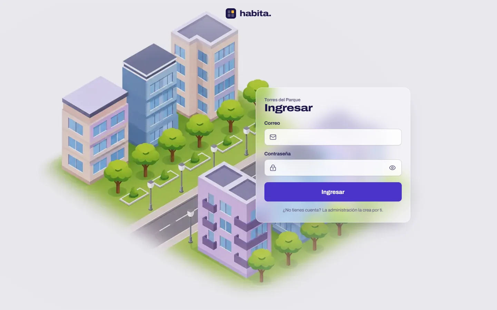
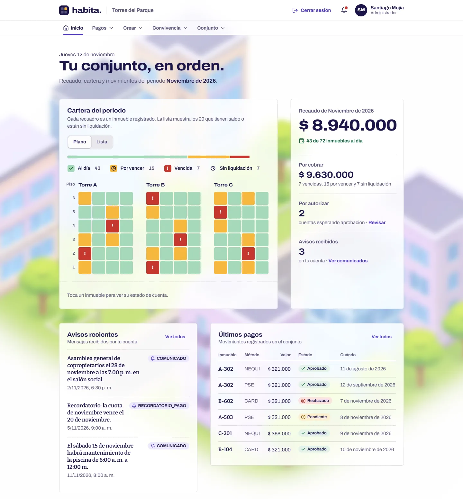
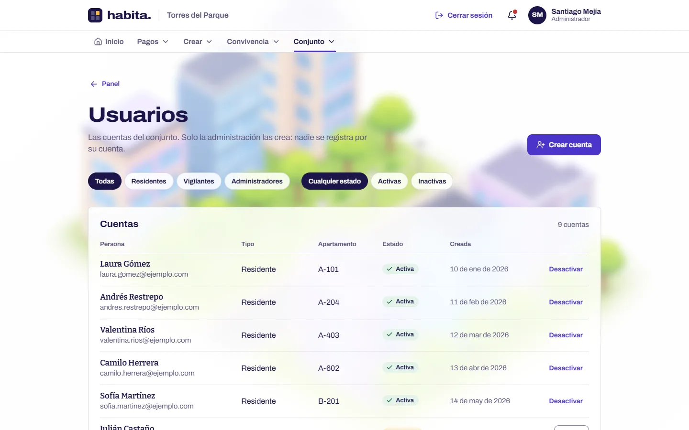
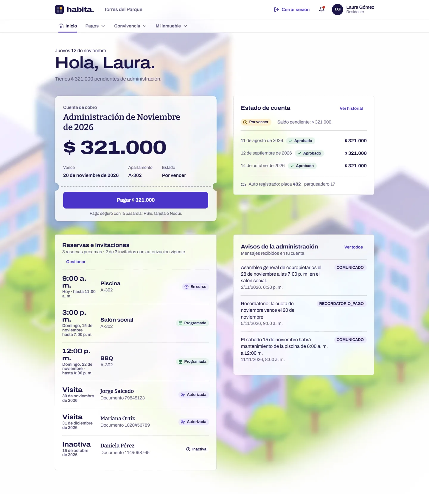
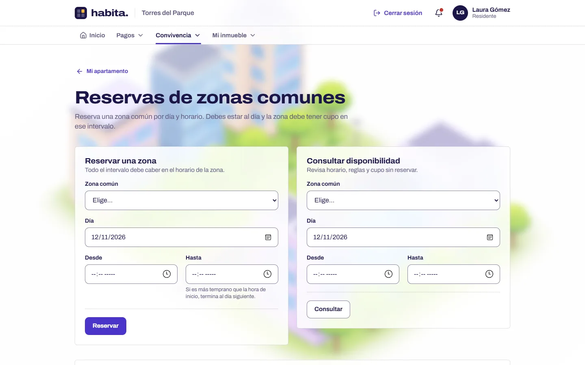
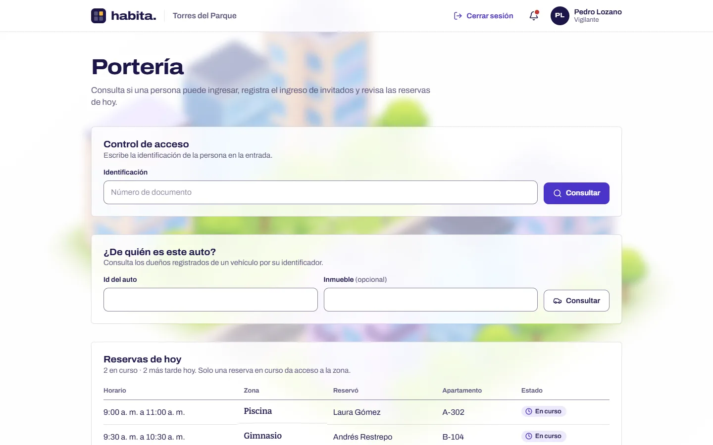
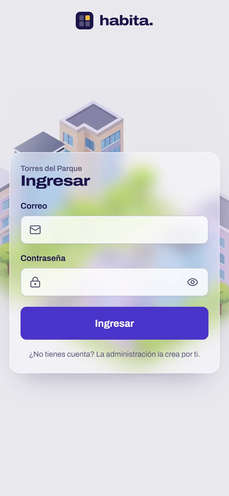
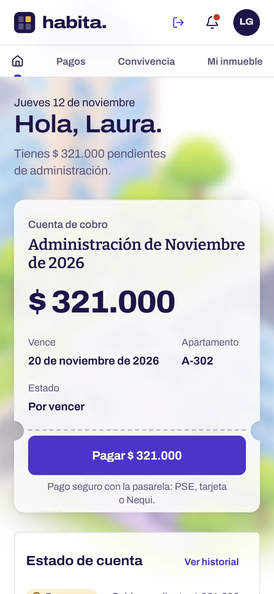
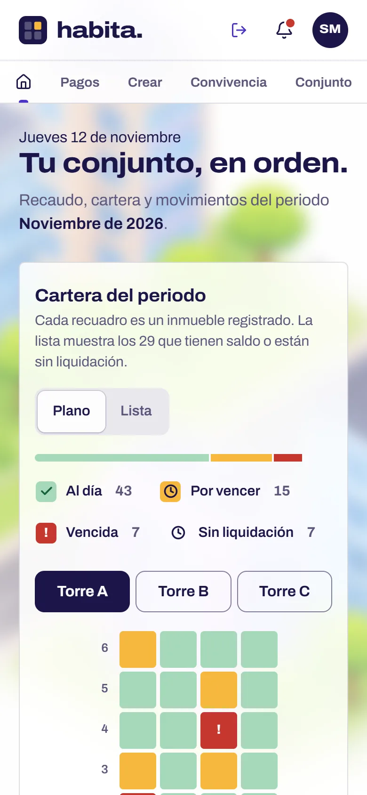

<div align="center">


# habita.

**Gestión residencial para Torres del Parque**: pagos, reservas y accesos desde el computador o el teléfono.




</div>

## Módulos

Hay un solo ingreso, y cada persona llega a su propio módulo según su rol.

| Módulo | Ruta | Pantallas |
|---|---|---|
| Administración | `/admin` | Tablero, usuarios, inmuebles, liquidaciones, pagos y comprobantes, zonas comunes, reglas de reserva, notificaciones |
| Residente | `/residente` | Tablero con saldo y pago, reservas por fecha y hora, invitados, vehículo, comprobantes, notificaciones |
| Portería | `/vigilante` | Registro rápido del ingreso de invitados |

## Capturas

> Hechas con datos de demostración: los nombres y las cifras son inventados.

### Administración

El tablero muestra la cartera del mes en un plano de las torres: cada recuadro es un apartamento, pintado según su estado de pago.





### Residente

La cuenta de cobro tiene forma de talón, con el botón de pago, y al lado van el estado de cuenta, las reservas, los invitados y los avisos.





### Portería



### En el teléfono

<p align="center">
  
  &nbsp;
  
  &nbsp;
  
</p>

## Stack

- **[Next.js 16](https://nextjs.org)** con App Router, Server Components y Server Actions
- **React 19** y **TypeScript**
- **Tailwind CSS 4** para los tokens del tema y **CSS Modules** para el estilo de cada componente
- **[Base UI](https://base-ui.com)** y componentes al estilo shadcn
- **[Lucide](https://lucide.dev)** para los iconos
- **pnpm**

> Esta versión de Next.js cambia cosas respecto a las anteriores (por ejemplo, `middleware.ts` ahora se llama `proxy.ts`). Antes de escribir código, consulta la guía en `node_modules/next/dist/docs/`.

## Empezar

```bash
pnpm install
pnpm dev
```

Abre [http://localhost:3000](http://localhost:3000).

| Comando | Uso |
|---|---|
| `pnpm dev` | Servidor de desarrollo con recarga en caliente |
| `pnpm build` | Build de producción |
| `pnpm start` | Sirve el build de producción |

En desarrollo la app consume la API en `http://localhost:8080`, y en producción la API desplegada. Para apuntar a otra, crea un `.env.local` con `API_URL=<url>`. El contrato de la API está en [`ENDPOINTS.md`](ENDPOINTS.md).

## Diseño

### Identidad visual

- **Fondo:** una ilustración de ciudad de noche (`public/ciudad-noche.webp`), vista a través de superficies de vidrio esmerilado (`backdrop-filter`).
- **Paleta:** está definida como variables CSS en `app/globals.css`, con nombres propios del proyecto:
  - `--tinta`: texto, un violeta-azul oscuro en lugar de negro
  - `--sello`: acciones, enlaces y foco
  - `--concreto` y `--papel`: el fondo y las superficies
  - `--lampara`: lo que está ocurriendo ahora
  - estados `--ok`, `--espera` y `--alerta`, cada uno con su tinte

  Tailwind y los componentes shadcn leen esos mismos tokens.
- **Contraste:** los textos secundarios cumplen WCAG AA sobre todos los fondos.

### Tipografía

| Fuente | Rol |
|---|---|
| **Archivo** | Interfaz y cifras. Su eje de ancho permite cifras tipo placa sin cargar una segunda familia |
| **Bitter 600** | La voz humana: saludos, nombres y títulos de comunicados |

Las dos se cargan con `next/font`: se sirven desde el propio dominio, sin saltos de diseño y solo con los pesos que se usan.

### Responsive y accesibilidad

- Todas las pantallas funcionan desde **320 px** de ancho y nada se sale de la pantalla.
- En el teléfono las tablas se convierten en **tarjetas** (atributo `data-cards` en el kit de gestión).
- En pantallas táctiles los controles crecen (`@media (pointer: coarse)`).
- Se respetan la muesca y las esquinas redondeadas del teléfono (`viewport-fit: cover` y `env(safe-area-inset-*)`).
- Las animaciones se apagan con `prefers-reduced-motion`.
- Mientras cargan los datos, cada pantalla muestra un **esqueleto** con la misma forma que la vista real (`loading.tsx` y `components/shell/cargando.tsx`).

## Componentes destacados

| Componente | Qué hace |
|---|---|
| `shell/app-shell` | Marco de cada módulo: encabezado, menú y contenido |
| `shell/menu-modulos` | Menú horizontal agrupado por tema; se abre al pasar el mouse o al tocar |
| `gestion/*` | Kit compartido de las pantallas de administración: encabezado, panel, tablas, campos y acciones |
| `modules/tower-plan` | Plano de las torres con el estado de pago de cada unidad; en pantallas angostas pasa a pestañas por torre |
| `modules/pagos/talon-pago` | Tarjeta de saldo con el selector de método de pago |
| `ui/plate` | La dirección de una unidad (torre + apartamento), igual en todos los módulos |
| `ui/chip`, `ui/chip-reserva` | Estados: reservas (programada, en curso, finalizada) y pagos |
| `ui/notice` | Avisos de éxito, espera y error |

## Estructura

```
app/
  ingresar/        Pantalla de ingreso
  admin/           Módulo de administración
  residente/       Módulo del residente
  vigilante/       Módulo de portería
  globals.css      Tokens de diseño, tema y estilos base
components/
  brand/           Logo
  gateway/         Pantalla de acceso y formulario
  shell/           Marco, menú y esqueletos de carga
  gestion/         Kit visual de las pantallas de gestión
  modules/         Tableros y piezas propias de cada módulo
  ui/              Componentes básicos
lib/               Sesión, llamadas a la API y Server Actions de cada módulo
proxy.ts           Protege las rutas de cada módulo y renueva la sesión
public/            Ilustración de fondo, íconos y logos
```

## Sesión

Los tokens viajan en cookies `httpOnly` y el JavaScript del navegador nunca los ve. `proxy.ts` revisa la sesión antes de abrir cada módulo: si el token venció, la renueva sin pedir el ingreso otra vez, y si no hay sesión, manda a `/ingresar`.
